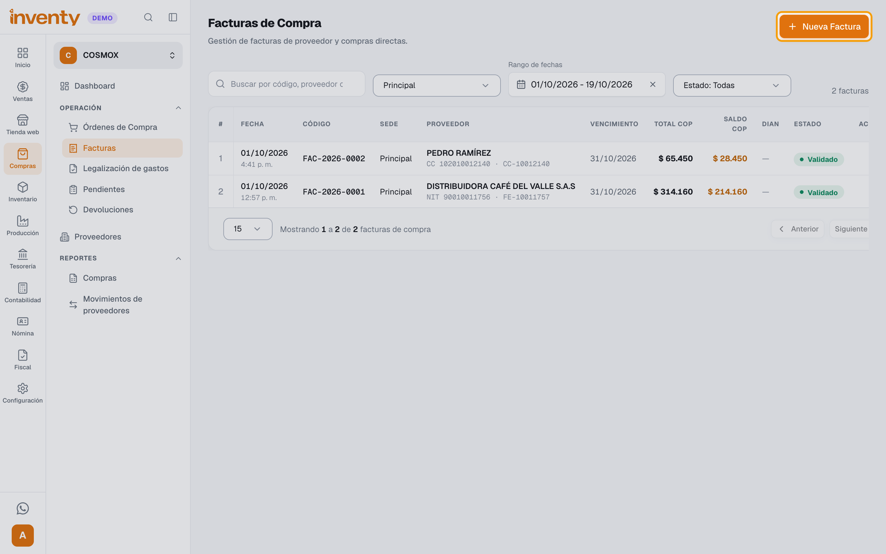
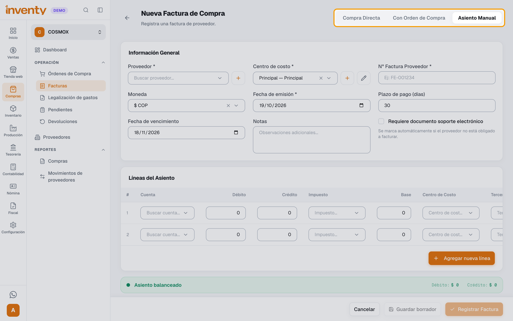
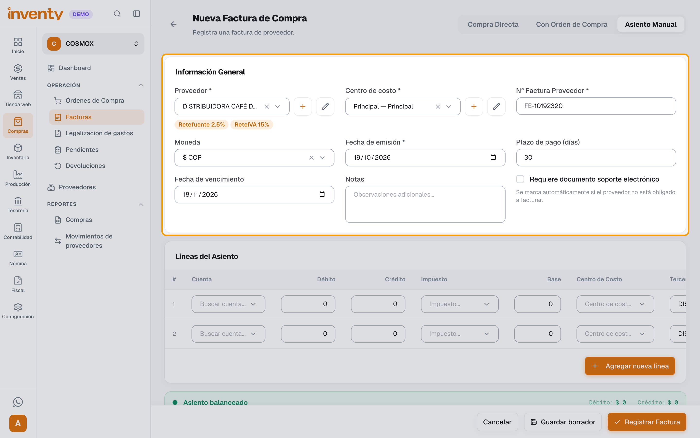
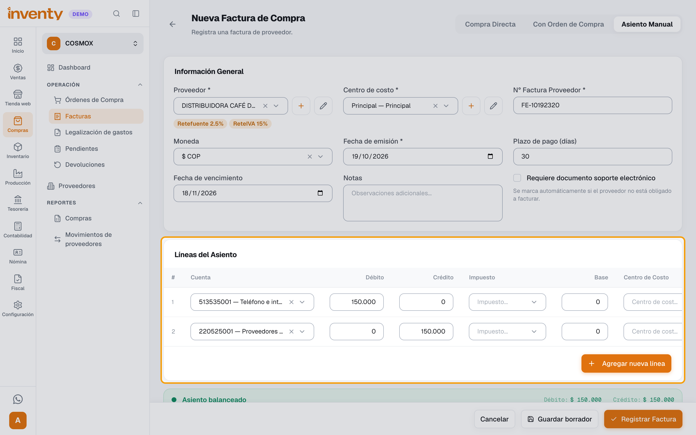
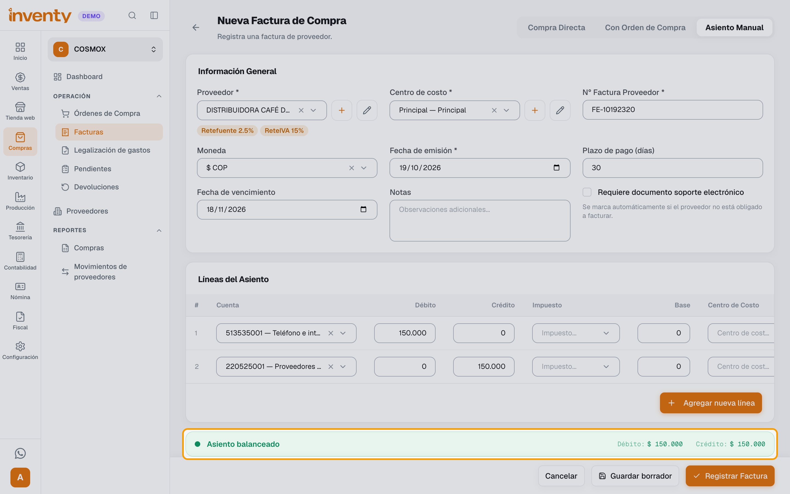
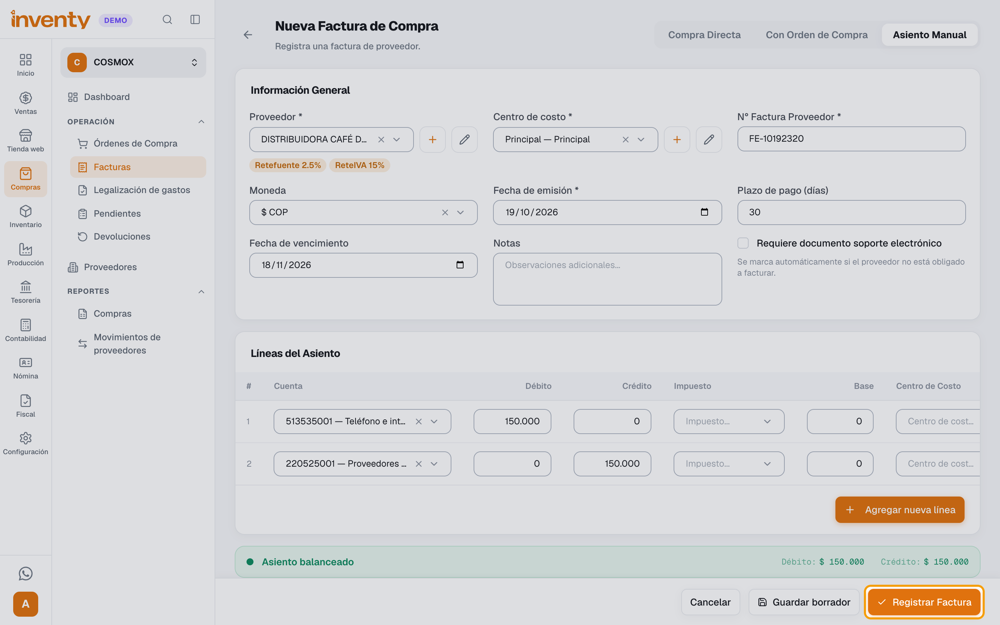

# ¿Cómo registro un gasto de un proveedor con asiento manual?

También se busca como: asiento manual en compras, factura sin productos, registrar arriendo, registrar servicios públicos, honorarios, factura de gasto, compra de activo fijo, contabilizar factura de proveedor.

**Antes de empezar:** la empresa debe tener **Contabilidad** activa. Úsalo para facturas que **no son mercancía para vender** (arriendo, servicios, honorarios, un computador para la oficina). Si compras mercancía, usa [Compra Directa](registrar-factura-compra.md): el asiento manual **no mueve inventario**.

## Pasos

**Paso 1.** Ingresa a Compras › Facturas y haz clic en **Nueva Factura**.

**Paso 2.** Elige el modo **Asiento Manual**. Si ya habías agregado productos, confirma: se eliminan.

**Paso 3.** En **Información General** completa **Proveedor**, **Centro de costo**, **N° Factura Proveedor** y **Fecha de emisión**. Si es a plazo, escribe el **Plazo de pago (días)** o la **Fecha de vencimiento**.

**Paso 4.** En **Líneas del Asiento**, por cada línea elige la **Cuenta** y escribe el **Débito** o el **Crédito** (no ambos). Elige el **Centro de Costo** de cada línea y revisa el **Tercero** (se llena con el proveedor). Si la línea es de un impuesto, elige el **Impuesto** y escribe la **Base**. Usa **Agregar nueva línea** para más cuentas.

!!! example "Ejemplo: factura de internet por $150.000"
    | Cuenta | Débito | Crédito |
    |---|---|---|
    | *513535001 — Teléfono e internet* (gasto) | $150.000 | |
    | *220525001 — Proveedores de servicios* (lo que le debes) | | $150.000 |

    Las cuentas exactas las define tu contador.

[PENDIENTE DE VALIDACIÓN FUNCIONAL: Inventy calcula lo que se le debe al proveedor sumando todas las líneas de **Crédito**. Confirmar cómo queda ese saldo cuando una línea de crédito es una retención.]

**Paso 5.** Revisa que el resumen diga **Asiento balanceado** (los débitos suman lo mismo que los créditos).

**Paso 6.** Haz clic en **Registrar Factura** y, en **¿Validar factura?**, haz clic en **Validar factura**. Si aún no está lista, usa **Guardar borrador**.

✅ **Listo:** la factura queda validada, se registra el asiento y queda la deuda con el proveedor. Págala con un [egreso](../finanzas/registrar-egreso.md).

## Si algo falla

| Problema | Solución |
|---|---|
| No aparece **Asiento Manual** | Activa **Contabilidad** en Configuración › Módulos. |
| *El asiento contable no está balanceado. La suma de débitos debe ser igual a la suma de créditos.* | Mira la **Diferencia** en el resumen y corrige los valores. |
| *Una línea no puede tener débito y crédito al mismo tiempo.* | Deja un solo valor por línea. |
| *La base es obligatoria cuando se selecciona un impuesto.* | Escribe la **Base** de esa línea o quita el **Impuesto**. |
| *El centro de costo es obligatorio en cada línea.* | Elige el **Centro de Costo** en todas las líneas. |
| *El número de factura ya existe para este proveedor.* | Ya se registró: búscala en la lista. |
| La compra no subió el inventario | El asiento manual no mueve inventario. Para mercancía, usa [Compra Directa](registrar-factura-compra.md). |

## Relacionados

- [¿Cómo registro una factura de compra?](registrar-factura-compra.md)
- [¿Cómo registro un pago a un proveedor?](../finanzas/registrar-egreso.md)
- [¿Cómo funciona la contabilidad en Inventy?](../contabilidad/como-funciona.md)
