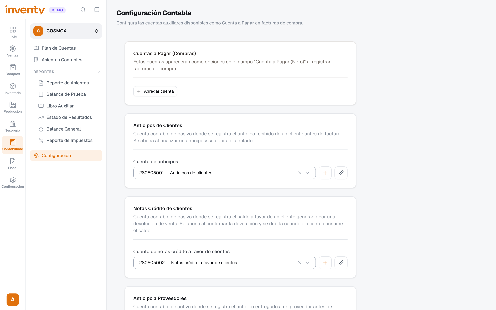
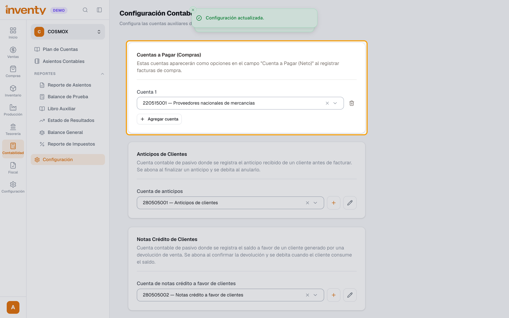
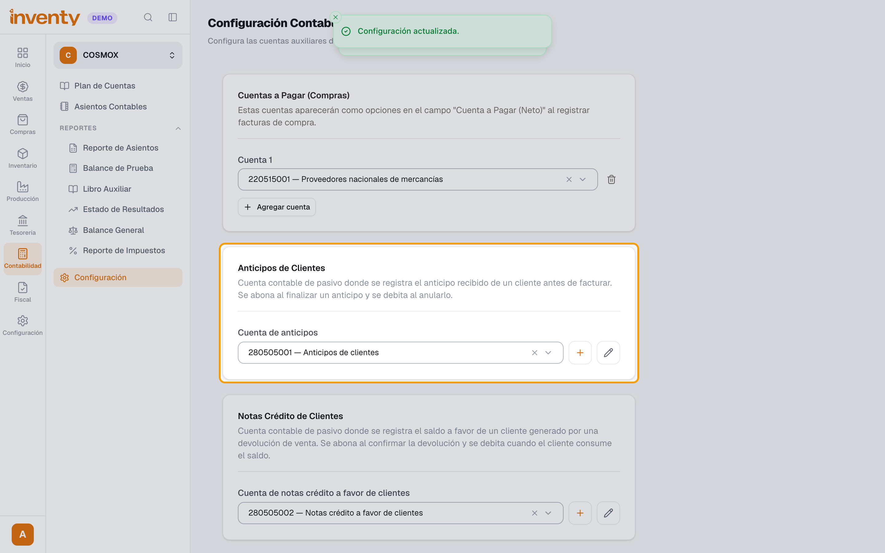
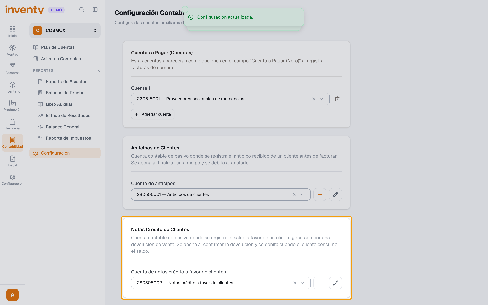
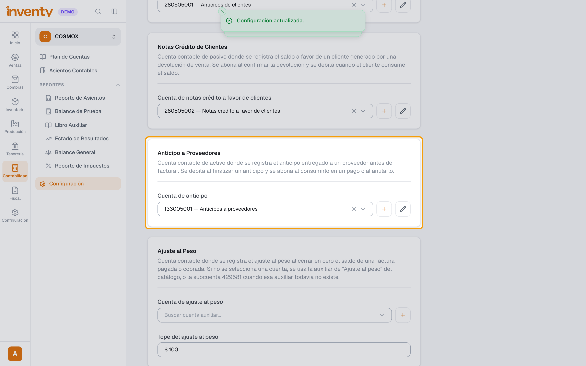
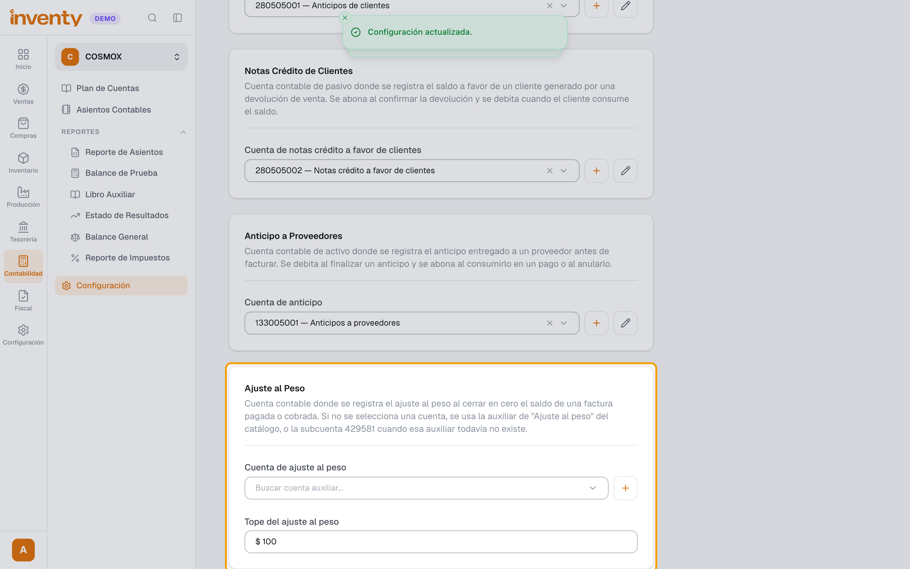
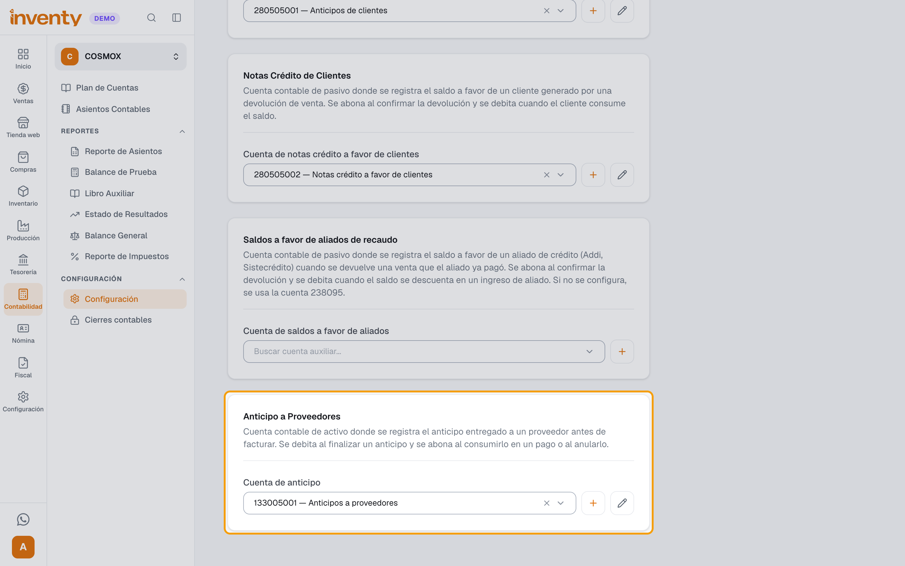

# ¿Cómo hago la configuración contable inicial?

También se busca como: configuración contable, cuentas a pagar, cuenta de proveedores, no hay cuentas configuradas, cuenta de anticipos, notas crédito, Addi, Sistecrédito, parametrizar contabilidad.

**Antes de empezar:** carga primero las [cuentas auxiliares por defecto](cuentas-auxiliares.md): asignan casi todo solo.

## Pasos

**Paso 1.** Ingresa a Contabilidad › Configuración.

**Paso 2.** En **Cuentas a Pagar (Compras)**, haz clic en **Agregar cuenta**.

**Paso 3.** En la fila nueva, busca y elige la cuenta de proveedores (ej. *Proveedores nacionales*). Puedes agregar varias: aparecerán en el campo **Cuenta a Pagar (Neto)** de cada factura de compra.

**Paso 4.** En **Anticipos de Clientes**, revisa la **Cuenta de anticipos** (pasivo donde queda el dinero que el cliente paga por adelantado).

**Paso 5.** En **Notas Crédito de Clientes**, revisa la **Cuenta de notas crédito a favor de clientes** (saldo a favor que generan las devoluciones).

**Paso 6.** Si vendes con Addi o Sistecrédito, en **Saldos a favor de aliados de recaudo** revisa la **Cuenta de saldos a favor de aliados**.

**Paso 7.** En **Anticipo a Proveedores**, revisa la **Cuenta de anticipo** (activo).

✅ **Listo:** los cambios se guardan solos (verás *Configuración actualizada.*). Ya puedes registrar compras, anticipos y devoluciones con contabilidad.

!!! info "¿Y el ajuste al peso?"
    Ya no está en esta pantalla. Su cuenta y su tope se configuran en Tesorería › Cartera › Conceptos de ajuste de pagos.

## Si algo falla

| Problema | Solución |
|---|---|
| Al registrar una compra: *No hay cuentas configuradas. Configura las cuentas en Contabilidad → Configuración.* | Agrega al menos una cuenta en **Cuentas a Pagar (Compras)** (pasos 2 y 3). |
| No aparecen cuentas para elegir | Carga las [cuentas auxiliares por defecto](cuentas-auxiliares.md) o crea la que necesites. |
| No veo **Configuración** en el menú Contabilidad | Tu rol necesita el permiso **Ver configuración contable**. |
| No encuentro **Ajuste al Peso** | Ahora está en Tesorería › Cartera › Conceptos de ajuste de pagos. |

## Relacionados

- [¿Cómo cargo y creo cuentas auxiliares?](cuentas-auxiliares.md)
- [¿Cómo funciona la contabilidad en Inventy?](como-funciona.md)
- [¿Cómo registro una factura de compra?](../compras/registrar-factura-compra.md)
