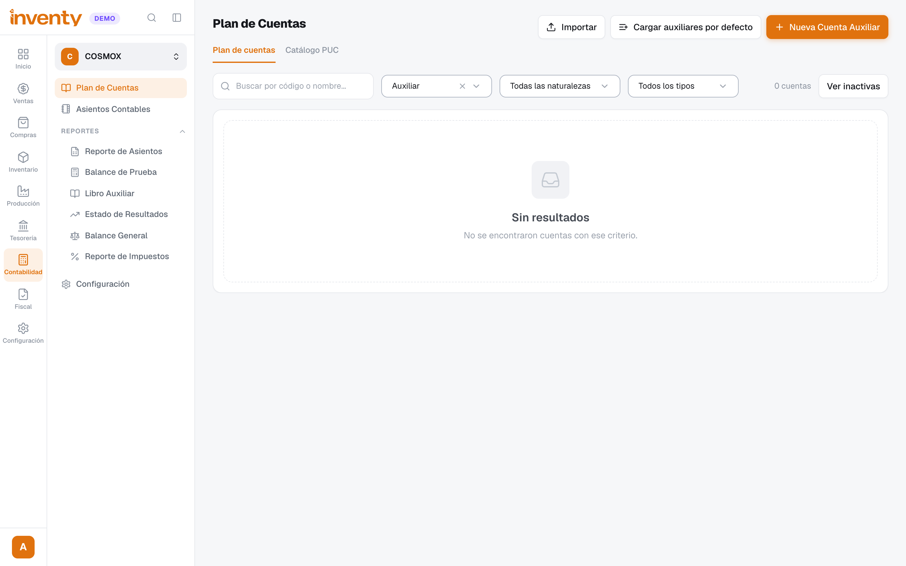
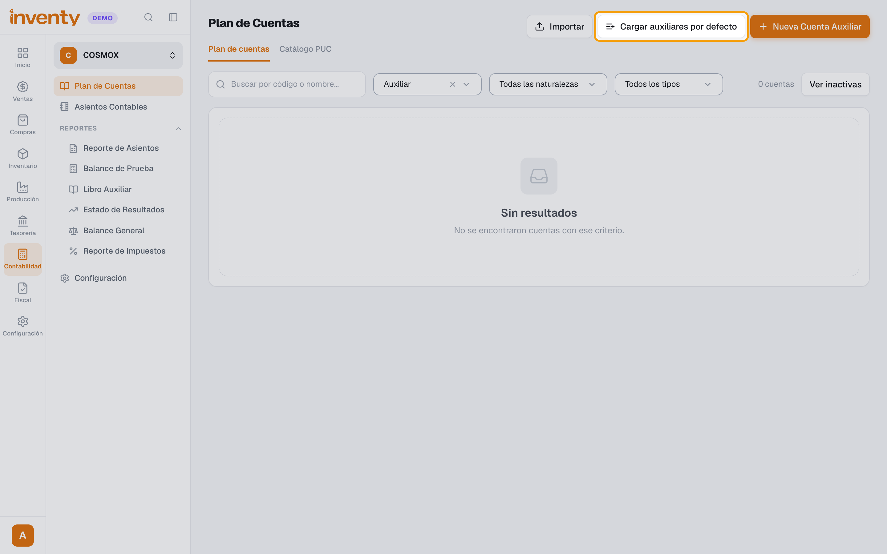
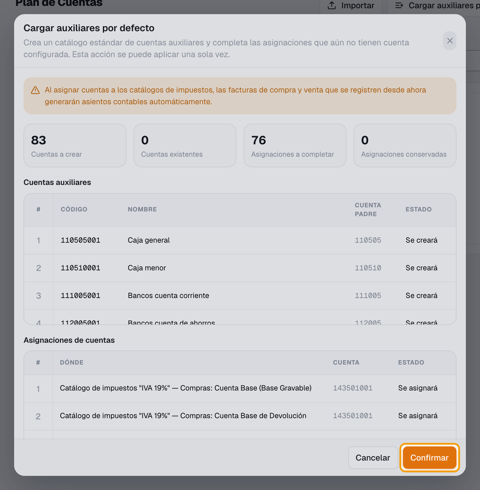
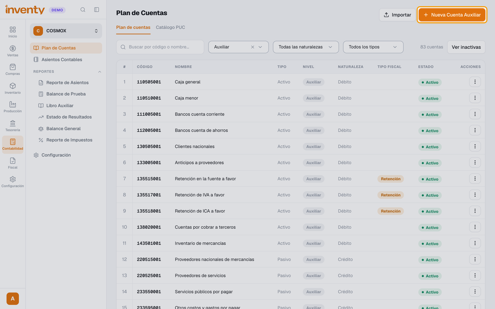
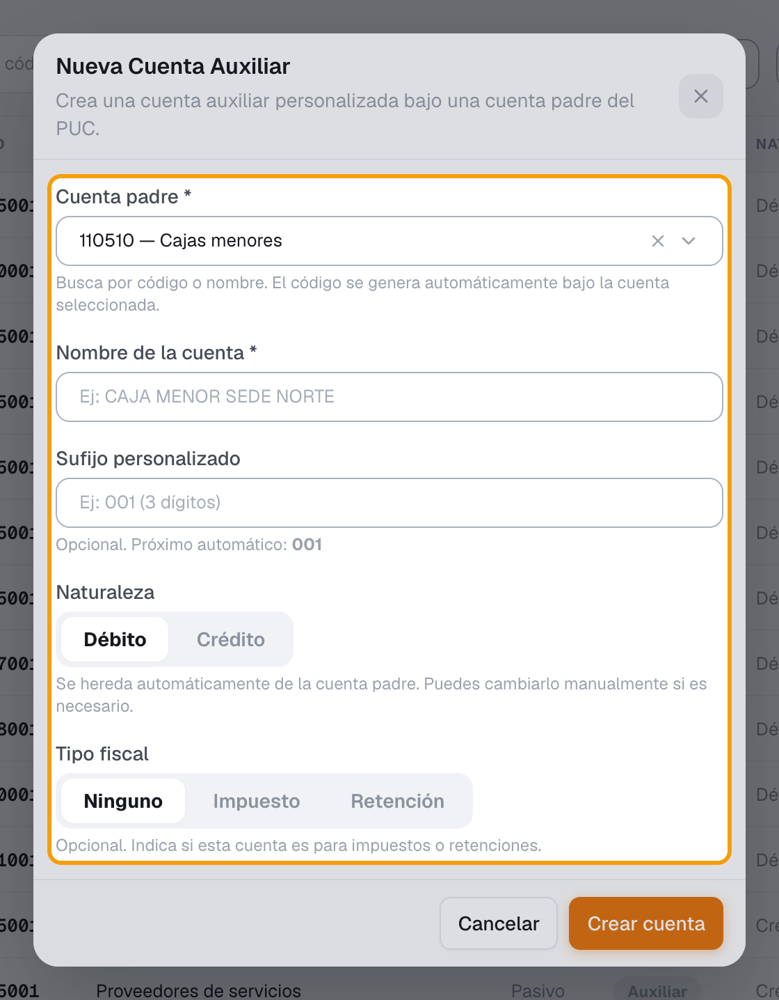
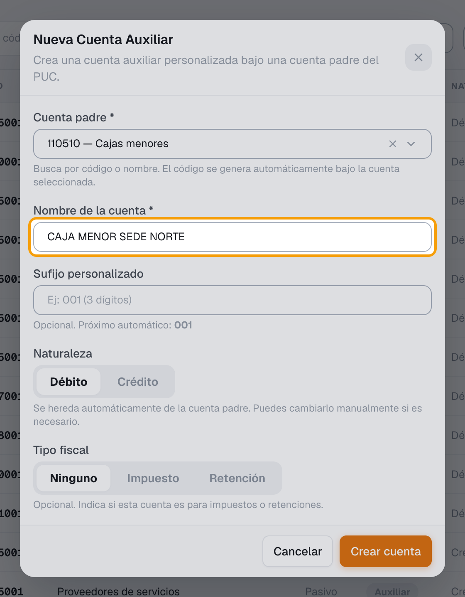
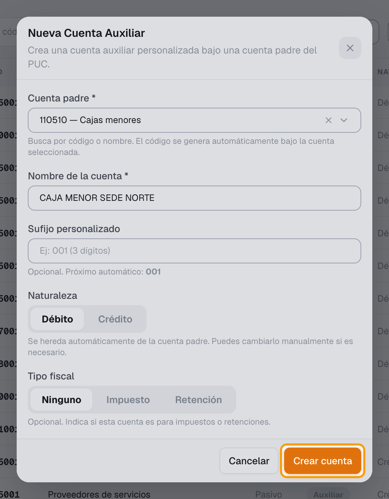

# ¿Cómo cargo y creo cuentas auxiliares?

También se busca como: cuenta auxiliar, auxiliares, crear cuenta contable, cuenta propia, PUC, plan de cuentas, subcuenta, código contable, caja menor, cuentas por defecto.

**Antes de empezar:** el módulo **Contabilidad** debe estar activo.

## Pasos

**Cargar las cuentas por defecto** (solo la primera vez)

**Paso 1.** Ingresa a Contabilidad › Plan de Cuentas.

**Paso 2.** Haz clic en **Cargar auxiliares por defecto**.

**Paso 3.** Revisa la vista previa (**Cuentas auxiliares** y **Asignaciones de cuentas**), haz clic en **Confirmar** y luego en **Sí, aplicar**.

**Crear una cuenta propia**

**Paso 4.** En Contabilidad › Plan de Cuentas, haz clic en **Nueva cuenta propia**.

**Paso 5.** Deja **Tipo de cuenta** en **Auxiliar** y, en **Cuenta padre**, busca la subcuenta del PUC donde va la cuenta (ej. *110510 Caja menor*).

**Paso 6.** Completa **Nombre de la cuenta** (ej. *CAJA MENOR SEDE NORTE*) y revisa **Naturaleza** y **Tipo fiscal**. El código se genera solo; si quieres, escribe un **Sufijo personalizado** de 3 dígitos.

**Paso 7.** Haz clic en **Crear cuenta auxiliar**.

✅ **Listo:** la cuenta aparece en el plan de cuentas con nivel **Auxiliar** y la etiqueta *personalizada*, y ya se puede elegir en los campos **Buscar cuenta auxiliar...** (cajas, bancos, catálogos de impuestos, medios de pago, nómina…).

## Si algo falla

| Problema | Solución |
|---|---|
| No aparece **Cargar auxiliares por defecto** | Ya se cargaron antes. Crea las cuentas que falten con **Nueva cuenta propia**. |
| *Solo se pueden crear cuentas auxiliares bajo una Subcuenta.* | Elige como **Cuenta padre** una subcuenta de 6 dígitos, no una clase, grupo o cuenta. |
| La subcuenta que necesito no existe en el PUC | En **Tipo de cuenta** elige **Subcuenta**: se crea bajo una cuenta de 4 dígitos. |
| *El código de cuenta … ya existe. Intenta con un sufijo diferente.* | Cambia el **Sufijo personalizado** o déjalo vacío para que se genere solo. |
| No encuentro una subcuenta del PUC | Actívala en la pestaña **Catálogo PUC** de la misma pantalla y vuelve a intentar. |
| No veo el botón **Nueva cuenta propia** | Tu rol necesita el permiso **Crear plan de cuentas**. |
| *El asiento contable no está balanceado* al facturar | Falta asignar una cuenta auxiliar. **Cargar auxiliares por defecto** completa las que faltan. |
| Tengo muchas cuentas para crear | Usa **Importar** en la misma pantalla para cargarlas desde Excel. |

## Relacionados

- [¿Cómo hago la configuración contable inicial?](configuracion-contable.md)
- [¿Cómo funciona la contabilidad en Inventy?](como-funciona.md)
- [¿Qué es y cómo creo un catálogo de impuestos?](../impuestos/catalogo-impuestos.md)
