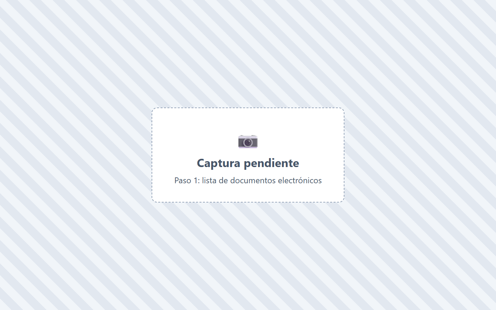
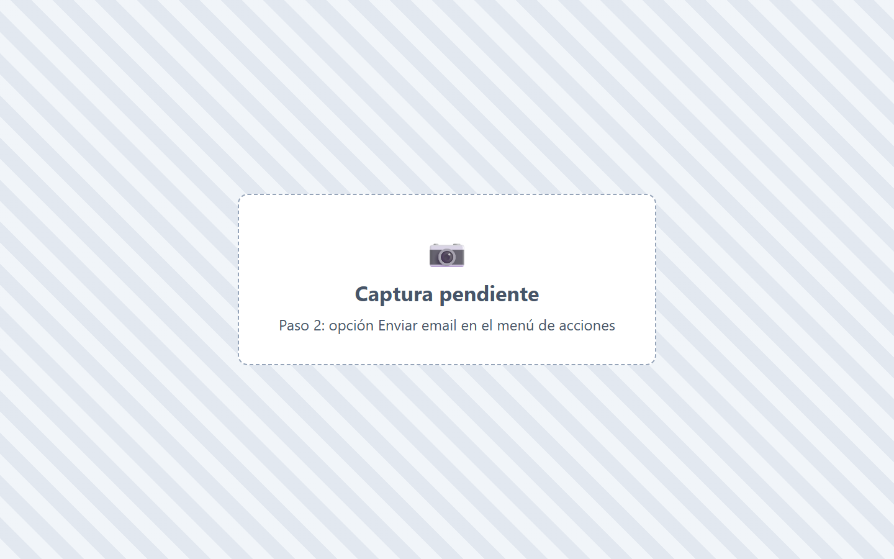
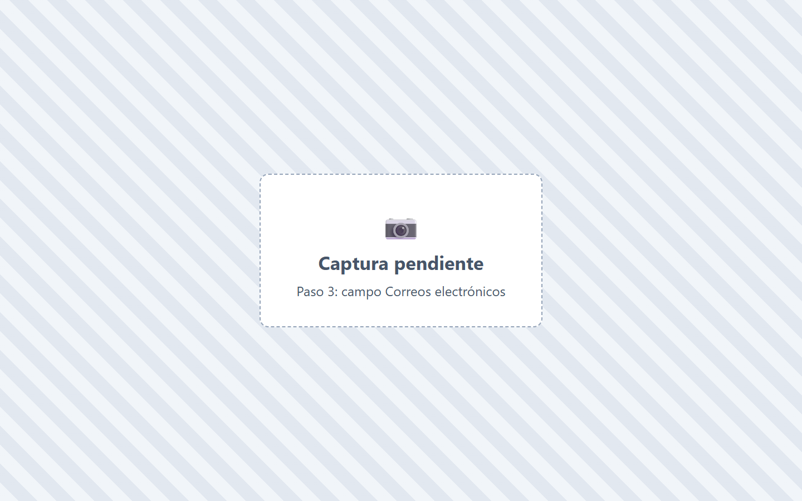
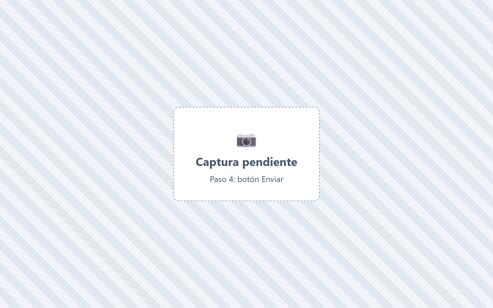

# ¿Cómo le reenvío por correo un documento electrónico al cliente?

También se busca como: no le llegó la factura, reenviar factura electrónica por correo, cliente sin correo, enviar factura de nuevo, correo equivocado, cliente no recibió la factura.

**Úsala cuando:** el cliente no tenía un correo activo cuando se emitió el documento, lo perdió, o simplemente no le llegó. No vuelve a emitir nada ante la DIAN: solo envía por correo el documento **que ya existe**.

**Antes de empezar:** el documento debe estar **Aceptado** o **Aceptado con observaciones** (necesita tener su archivo ZIP generado). Si está Pendiente, Rechazado o Falló prevalidación, primero debes [reenviarlo a la DIAN](estados-documento.md#acciones-disponibles) para que quede aceptado.

## Pasos

**Paso 1.** Ingresa a Fiscal › Documentos y busca el documento (por número de factura, cliente o NIT).

**Paso 2.** En el menú de acciones de esa fila, haz clic en **Enviar email**. Si no aparece, revisa que el documento esté Aceptado (ver "Antes de empezar").

**Paso 3.** En **Correos electrónicos**, escribe el correo (o varios, separados por punto y coma `;`) a donde quieres que llegue.

**Paso 4.** Haz clic en **Enviar**.

✅ **Listo:** Inventy envía el archivo ZIP del documento a los correos que escribiste. No queda guardado como el correo del cliente: cada vez que uses **Enviar email** escribes a dónde mandarlo.

!!! tip "¿Cliente sin correo registrado?"
    No hace falta corregir la ficha del cliente para reenviar el documento: en el paso 3 escribes cualquier correo, así no sea el que tiene guardado el cliente.

## Si algo falla

| Problema | Solución |
|---|---|
| No aparece **Enviar email** | El documento no tiene archivo ZIP todavía: está Pendiente, Desconocido, Rechazado o Falló prevalidación. [Reenvíalo primero](estados-documento.md#acciones-disponibles) para que quede Aceptado. |
| El cliente dice que no le llegó | Revisa que el correo esté bien escrito y la carpeta de spam. Si sigue sin llegar, vuelve a intentar o prueba con otro correo. |
| Necesito mandarlo a varias personas | Escribe todos los correos en el mismo campo, separados por `;` (ej. `contabilidad@cliente.com;gerencia@cliente.com`). |

## Relacionados

- [¿Qué significa cada estado de un documento electrónico?](estados-documento.md)
- [¿Cómo emito una factura electrónica?](emitir-factura-electronica.md)
- [¿Qué hago si un documento electrónico es rechazado?](documento-rechazado.md)
