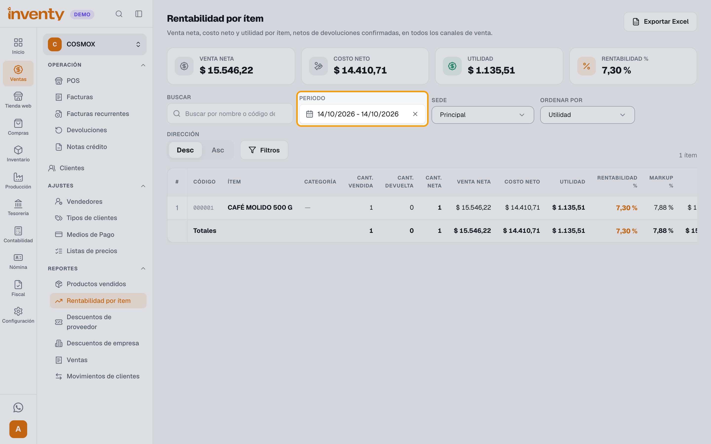
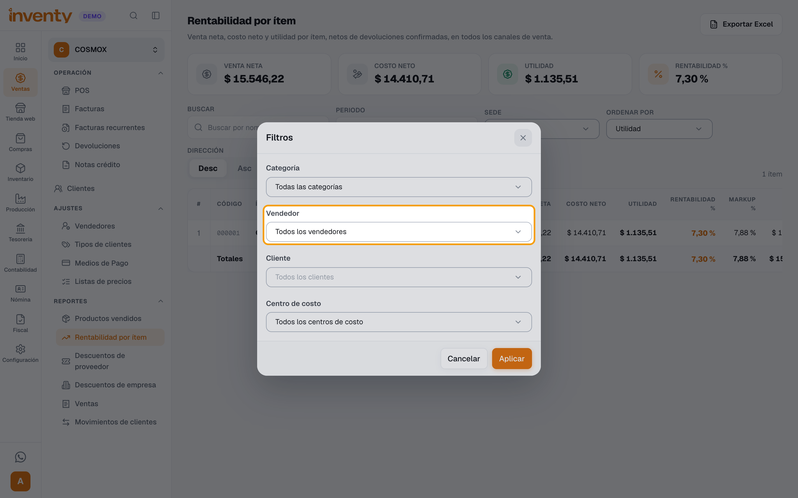
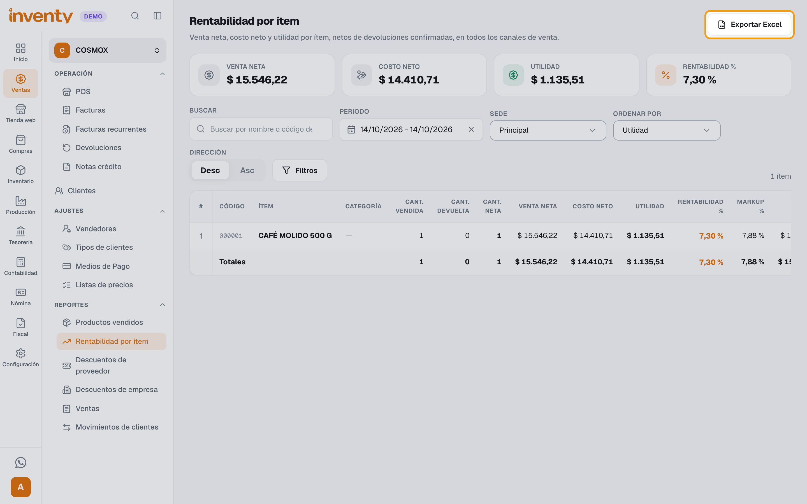
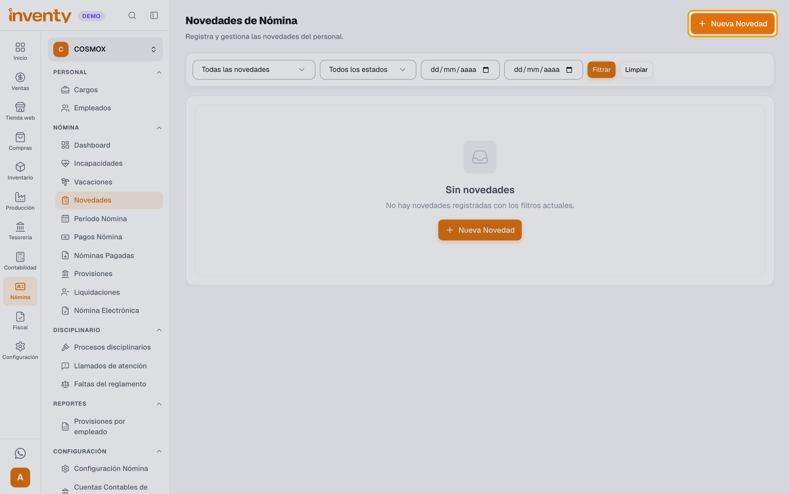
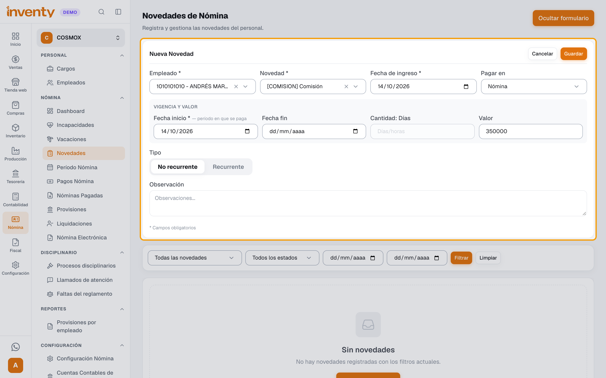
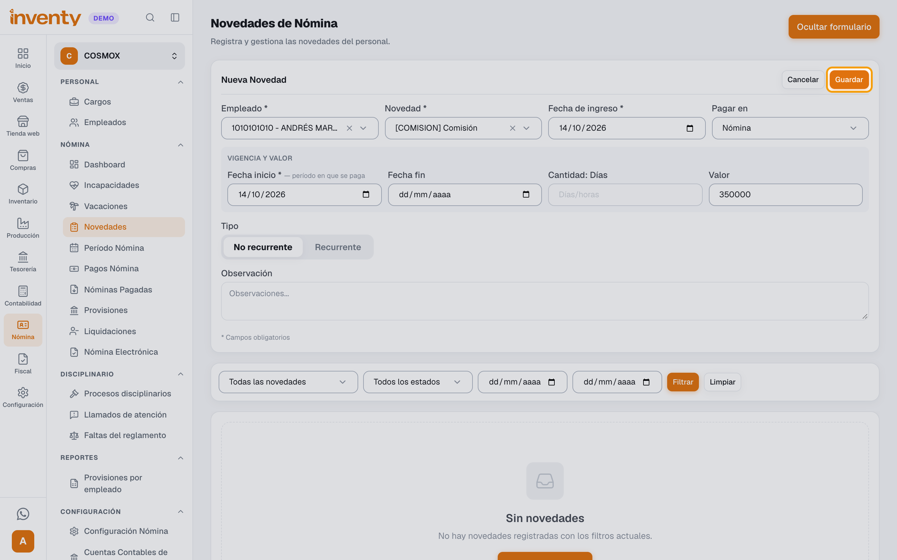

# ¿Cómo calculo y pago las comisiones de los vendedores?

También se busca como: comisión de ventas, comisiones de vendedores, liquidar comisiones, ventas por vendedor, pagar comisión en nómina.

**Antes de empezar:** Inventy no calcula la comisión por ti. Cada venta guarda el vendedor que la hizo; con eso sacas lo que vendió cada uno y registras su comisión como una [novedad de nómina](registrar-novedad.md). El vendedor debe estar registrado como [empleado](registrar-empleado.md).

## Pasos

**Paso 1.** Ingresa a Ventas › Reportes › Rentabilidad por ítem y elige en **Periodo** las fechas del período de nómina.

**Paso 2.** Haz clic en **Filtros**, selecciona el **Vendedor** y haz clic en **Aplicar**.

**Paso 3.** Toma el total de **Venta neta** (o de **Utilidad**, si así lo acordaste con el vendedor) y multiplícalo por su porcentaje de comisión. Si necesitas el detalle, haz clic en **Exportar Excel**.

**Paso 4.** Ingresa a Nómina › Nómina › Novedades y haz clic en **Nueva Novedad**.

**Paso 5.** Elige el **Empleado**, en **Novedad** selecciona **Comisión** y escribe en **Valor** el monto que calculaste.

**Paso 6.** Haz clic en **Guardar**.

✅ **Listo:** la comisión se paga en el período de nómina que incluye su fecha y sale en la nómina electrónica.

## Si algo falla

| Problema | Solución |
|---|---|
| El vendedor no aparece en **Filtros**. | Revisa que esté creado en Ventas › Ajustes › Vendedores. |
| Faltan ventas del vendedor. | Solo cuentan las ventas que tienen ese vendedor asignado. Revisa el vendedor en la factura. |
| La comisión no suma a la seguridad social. | En Nómina › Configuración Nómina, pestaña **Conceptos de Nómina**, revisa que **Comisión** tenga **Opera sobre IBC** en **Sí**. |
| El vendedor no es empleado. | Esta guía no aplica: su comisión se paga por fuera de la nómina. |

## Relacionados

- [¿Cómo registro una novedad de nómina?](registrar-novedad.md)
- [¿Cómo liquido y pago la nómina?](liquidar-nomina.md)
