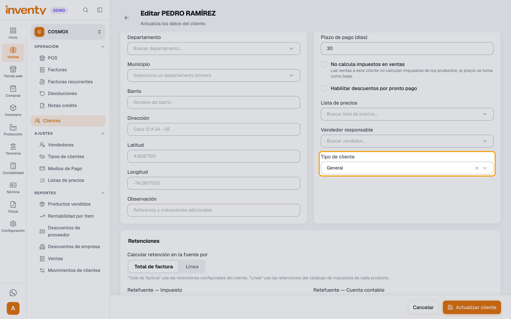
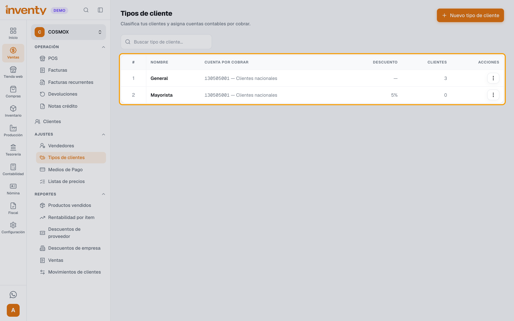

# Soluciones rápidas: ventas

## "Al validar la factura a crédito me pide configurar la cuenta contable"

**PROBLEMA:** al validar una factura **a crédito** aparece *“Configura una cuenta de cuentas por cobrar en el tipo de cliente para facturar a crédito con contabilidad activa.”*

**CAUSA:** la empresa usa Contabilidad y el cliente **no tiene tipo de cliente**, o su tipo de cliente **no tiene Cuenta por cobrar**. Que la cuenta 1305 esté activa en el plan de cuentas no es suficiente: Inventy toma la cuenta del **tipo de cliente** del cliente.

**SOLUCIÓN:**

1. Abre el cliente en Ventas › Clientes › **Editar** y mira **Tipo de cliente** (en **Datos del rol de cliente**).
2. Si está vacío, elige uno (ej. *General*) y haz clic en **Actualizar cliente**.

    

3. Si ya tiene tipo, ve a Ventas › Ajustes › Tipos de clientes (barra izquierda **Ventas** → sección **AJUSTES**), edita ese tipo y elige la **Cuenta por cobrar** (ej. *130505001 — Clientes nacionales*). Guarda.

    

4. Vuelve a la factura, ábrela con **Editar** y valídala desde ahí: al guardarla, toma la cuenta nueva. Si la validas sin editarla, puede seguir saliendo el mismo mensaje.

Si la venta es del POS, no hay factura que editar: después de los pasos 1 a 3, vuelve a cobrar la venta.

!!! tip "Evita que vuelva a pasar"
    Al crear un cliente, el **Tipo de cliente** no es obligatorio: si no lo eliges, queda vacío. Para saber si hay otros clientes sin tipo, suma la columna **Clientes** en Ventas › Ajustes › Tipos de clientes y compárala con el total de clientes: si da menos, hay clientes sin tipo.

**ESCALAR A SOPORTE:** si el tipo de cliente ya tiene cuenta, editaste la factura y el mensaje sigue.

**INFORMACIÓN PARA SOPORTE:** número de la factura, nombre del cliente, tipo de cliente, captura del mensaje.

## "No me deja vender a crédito"

**PROBLEMA:** aparece *“Este cliente no tiene cupo de crédito disponible.”* o *“El saldo a crédito supera el cupo disponible del cliente…”*

**CAUSA:** el **Límite de crédito** del cliente es 0 o ya está usado con otras facturas.

**SOLUCIÓN:**

1. Cobra una parte de contado y deja el resto a crédito.
2. O aumenta el **Límite de crédito** en la ficha del cliente (Ventas › Clientes).
3. En el POS, si tu empresa lo permite, un supervisor puede autorizar el cupo extra con su **PIN**.

**ESCALAR A SOPORTE:** si el cliente no tiene deudas y aun así no hay cupo.

**INFORMACIÓN PARA SOPORTE:** documento del cliente, cupo configurado, valor de la venta.

## "No puedo poner esa fecha en la factura"

**PROBLEMA:** aparece *“La fecha de emisión no puede ser una fecha futura.”*

**CAUSA:** las facturas no pueden tener fecha posterior a hoy.

**SOLUCIÓN:** usa la fecha de hoy o una anterior.

**ESCALAR A SOPORTE:** no aplica.

**INFORMACIÓN PARA SOPORTE:** —

## "No puedo anular una factura"

**PROBLEMA:** aparece *“No puedes anular una venta con movimientos de inventario.”* o *“…que incluye líneas convertidas desde una remisión.”*

**CAUSA:** esas facturas no se pueden anular porque ya afectaron el inventario o vienen de una remisión.

**SOLUCIÓN:** registra una [devolución de venta](../ventas/devolucion-venta.md) total.

**ESCALAR A SOPORTE:** si la devolución tampoco es posible.

**INFORMACIÓN PARA SOPORTE:** número de la factura, motivo.

## "Me equivoqué en una factura ya validada"

**PROBLEMA:** necesito cambiar una factura validada.

**CAUSA:** las facturas validadas no se pueden editar.

**SOLUCIÓN:** registra una [devolución](../ventas/devolucion-venta.md) (total o parcial) y crea una factura nueva con los datos correctos. Si solo está mal el medio de pago, no hagas devolución: ver [Me equivoqué en el medio de pago de una factura](#me-equivoque-en-el-medio-de-pago-de-una-factura).

**ESCALAR A SOPORTE:** si la factura ya fue aceptada por la DIAN y tienes dudas sobre cómo corregirla.

**INFORMACIÓN PARA SOPORTE:** número de la factura, qué dato está mal.

## "Me equivoqué en el medio de pago de una factura"

**PROBLEMA:** registré la venta en **Efectivo** y el cliente pagó por **Transferencia** (o al revés). Ahora la caja no cuadra.

**CAUSA:** el medio de pago de una factura validada no se puede cambiar. Inventy cuenta ese dinero en la caja o en el banco equivocado.

**SOLUCIÓN:** si la venta, el cliente y los valores están bien, no hagas una devolución: mueve el dinero a donde realmente está. Hazlo **antes de cerrar la caja**.

1. **Registraste Efectivo y pagaron por Transferencia:** ingresa a Tesorería › Consignaciones y haz clic en **Realizar consignación**. Elige la **Caja abierta**, la **Cuenta bancaria** donde entró la transferencia y el **Monto (COP)** de la venta. En **Referencia (opcional)** escribe el número de la factura. Haz clic en **Registrar consignación** y luego en **Confirmar consignación**.
2. **Registraste Transferencia y pagaron en Efectivo:** ingresa a Tesorería › Traslados y crea un **Nuevo traslado**. En **Dirección** elige **Banco → Caja**, la **Cuenta bancaria de origen**, la **Caja de destino**, la **Fecha** y el **Monto**. En **Observación** escribe el número de la factura. Haz clic en **Registrar traslado** y confirma.
3. Cierra la caja con el efectivo que contaste.

[PENDIENTE DE VALIDACIÓN FUNCIONAL: confirmar en la interfaz los pasos de la consignación y del traslado para corregir un medio de pago, y con contabilidad si la factura electrónica necesita nota crédito por este error.]

!!! warning "Si el error cambia contado por crédito"
    Si la factura quedó a crédito y era de contado (o al revés), sí afecta la cartera y la factura electrónica: haz una [devolución](../ventas/devolucion-venta.md) total y una factura nueva.

**ESCALAR A SOPORTE:** si la caja ya se cerró, o si no ves la caja abierta en la lista.

**INFORMACIÓN PARA SOPORTE:** número de la factura, medio registrado y medio real, valor, caja y fecha.

## "Dice que el asiento contable no está balanceado"

**PROBLEMA:** al validar aparece *“El asiento contable no está balanceado”*.

**CAUSA:** falta la cuenta contable de un producto, impuesto, medio de pago o de la configuración contable.

**SOLUCIÓN:** usa **Ver asientos** para ver qué línea queda sin cuenta y pide a tu contador que la configure en Contabilidad › Configuración o en el **Catálogo de Impuestos**.

**ESCALAR A SOPORTE:** si toda la configuración parece correcta.

**INFORMACIÓN PARA SOPORTE:** captura de **Ver asientos**, productos de la factura.
