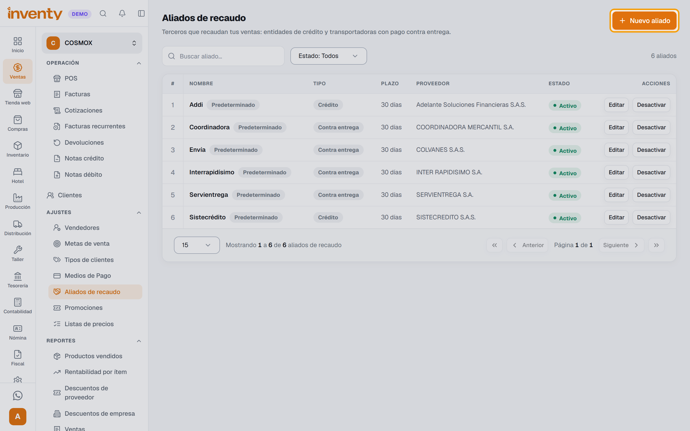
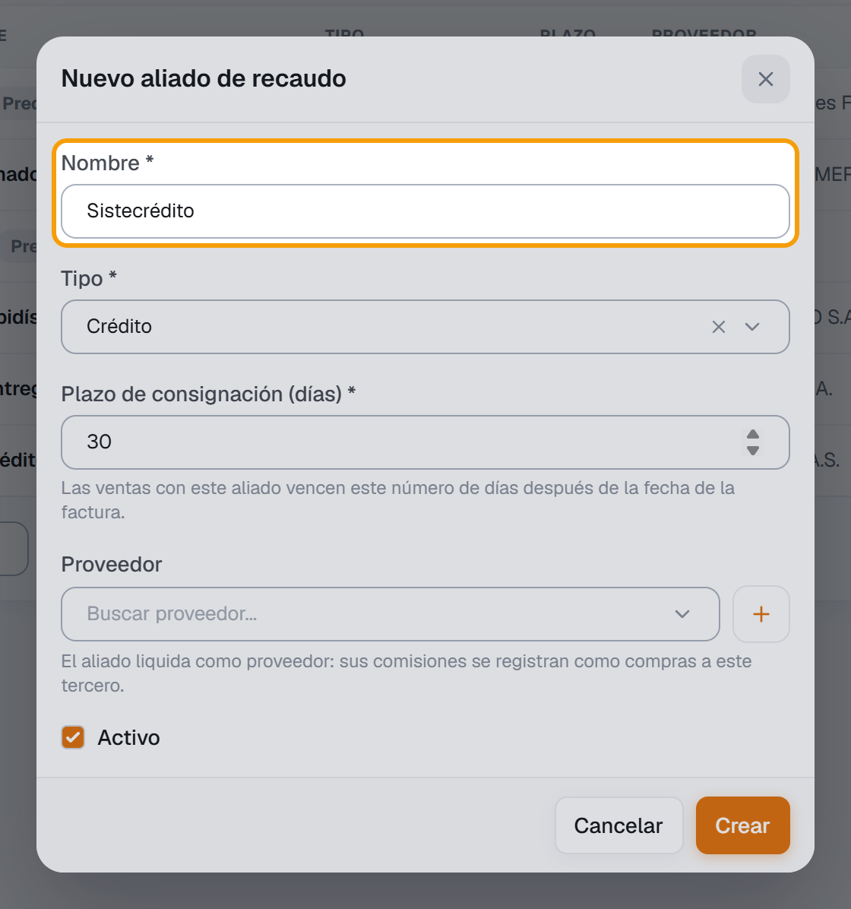
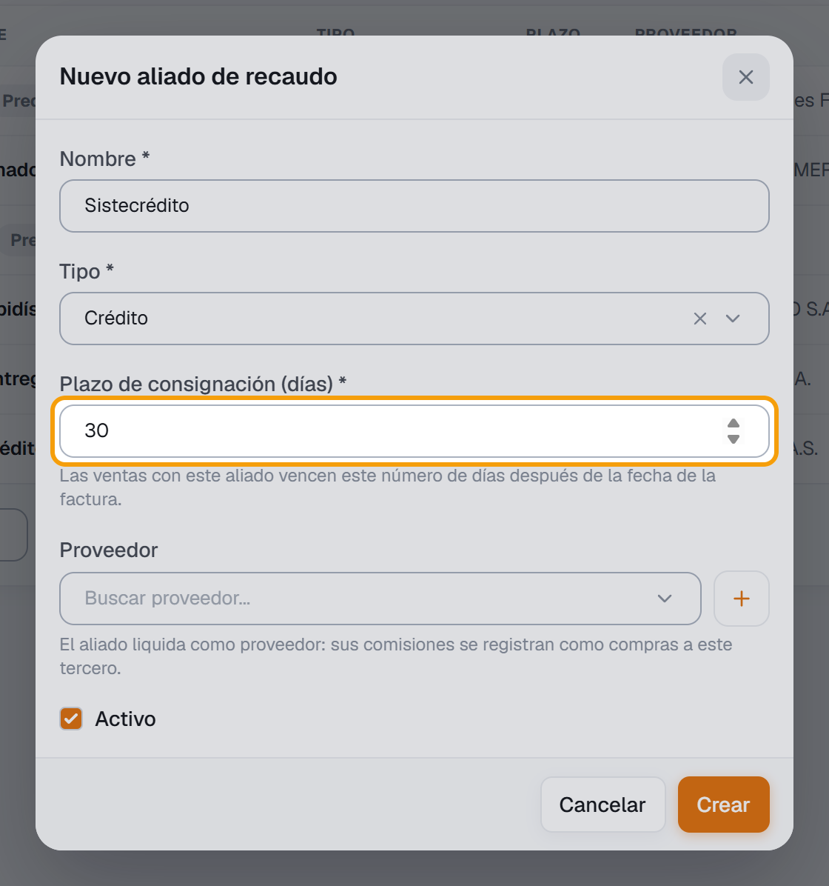
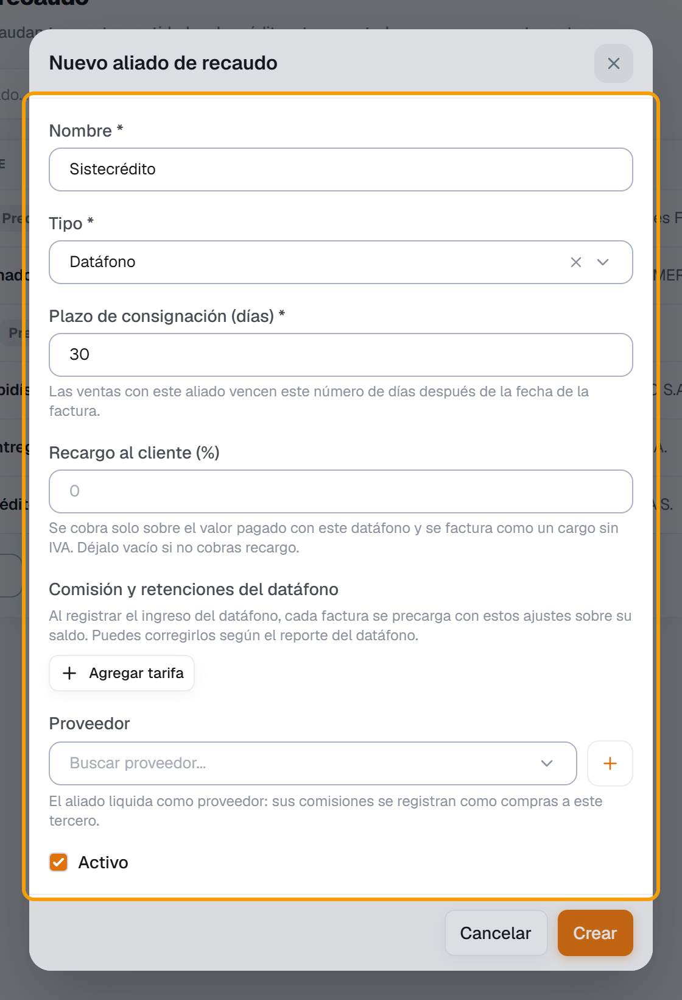
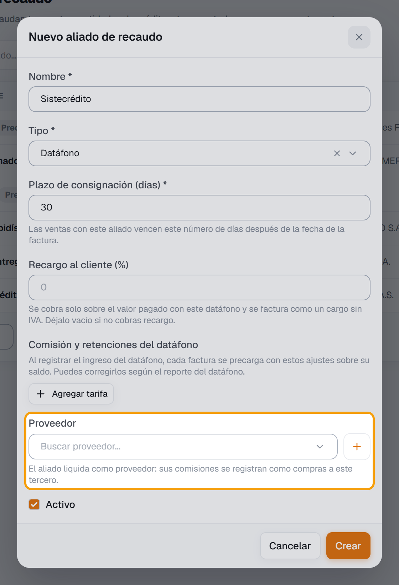
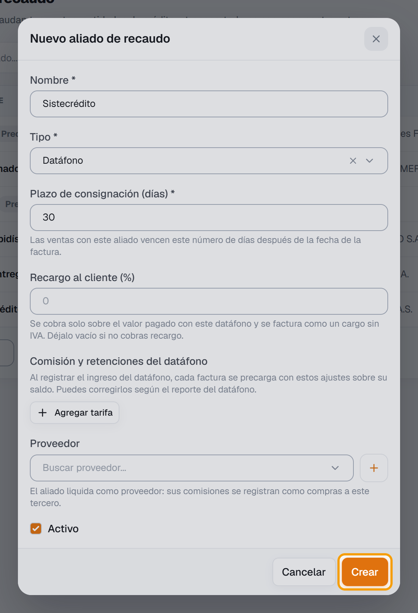

# ¿Cómo configuro un aliado de recaudo (Sistecrédito, Addi, Interrapidísimo, datáfono)?

También se busca como: aliado de recaudo, Addi, Sistecrédito, Payloo, Interrapidísimo, contra entrega, pago contra entrega, datáfono, comisión del datáfono, recaudo de terceros.

**Qué es:** un tercero que **cobra la venta por ti y te liquida después**, cobrando una comisión. Hay tres tipos:

| Tipo | Qué hace | Ejemplos |
|---|---|---|
| **Crédito** | Le presta al cliente, le paga la factura a Inventy y le cobra la cuota al cliente. | Addi, Sistecrédito, Payloo |
| **Contra entrega** | Recoge el pedido, le cobra al cliente al entregarlo y te consigna después. | Interrapidísimo, otra transportadora |
| **Datáfono** | Procesa el pago con tarjeta y te liquida neto de comisión y retenciones. | El datáfono de tu banco |

Esto es distinto de un **medio de pago** normal: ver [¿Cómo creo un medio de pago?](medios-de-pago.md) si solo necesitas una forma de pago (Nequi, transferencia…) sin un tercero que recaude por ti.

**Antes de empezar:** activa **Aliados de recaudo** en Configuración › Módulos › Ventas (desactivado por defecto). Sin esto, la opción no aparece en el menú ni en el buscador.

## Pasos

**Paso 1.** Ingresa a Ventas › Ajustes › Aliados de recaudo y haz clic en **Nuevo aliado**.

**Paso 2.** Escribe el **Nombre** (ej. *Sistecrédito*, *Interrapidísimo*) y elige el **Tipo**: **Crédito**, **Contra entrega** o **Datáfono**.

**Paso 3.** Escribe el **Plazo de consignación (días)**: las ventas con este aliado vencen ese número de días después de la fecha de la factura.

**Paso 4.** Si el tipo es **Datáfono**: escribe el **Recargo al cliente (%)** (se cobra solo sobre lo pagado con ese datáfono, como un cargo sin IVA; déjalo vacío si no cobras recargo) y agrega la **Comisión y retenciones del datáfono** con **Agregar tarifa** — cada factura pagada con este aliado se precarga con esos porcentajes, y los puedes corregir según el reporte real del datáfono.

**Paso 5.** (Opcional) Elige el **Proveedor**: el aliado liquida como proveedor — sus comisiones se registran como una compra a ese tercero.

**Paso 6.** Deja marcado **Activo** y haz clic en **Crear**.

✅ **Listo:** el aliado aparece como destino al registrar un [ingreso](../finanzas/registrar-ingreso.md) o al cobrar en el [POS](../pos/vender-en-pos.md), y la venta queda a su cargo hasta que liquide.

## Si algo falla

| Problema | Solución |
|---|---|
| No aparece **Aliados de recaudo** en el menú | Actívalo en Configuración › Módulos › Ventas. |
| No veo **Recargo al cliente** ni **Comisión y retenciones** | Esos campos solo aplican al tipo **Datáfono**. |
| *Crea primero los conceptos de ajuste de ingresos* | Antes de agregar una tarifa de comisión, crea los conceptos en [Tesorería › Cartera › Conceptos de ajuste de pagos](../contabilidad/configuracion-contable.md). |
| No sé qué cuenta contable usa | Ver [Saldos a favor de aliados de recaudo](../contabilidad/configuracion-contable.md) en la configuración contable. |

## Relacionados

- [¿Cómo creo un medio de pago y por qué no me sale Crédito en el POS?](medios-de-pago.md)
- [¿Cómo hago la configuración contable inicial?](../contabilidad/configuracion-contable.md)
- [¿Cómo registro un pago de un cliente?](../finanzas/registrar-ingreso.md)
