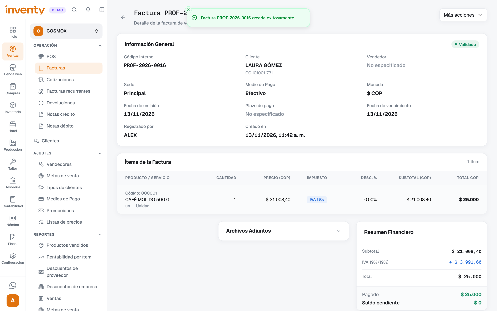
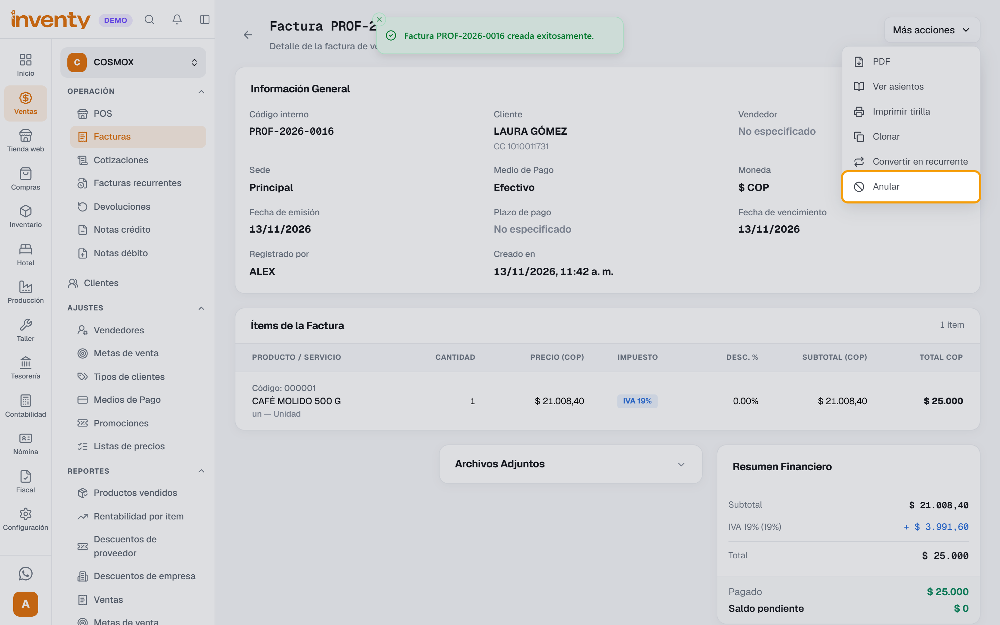
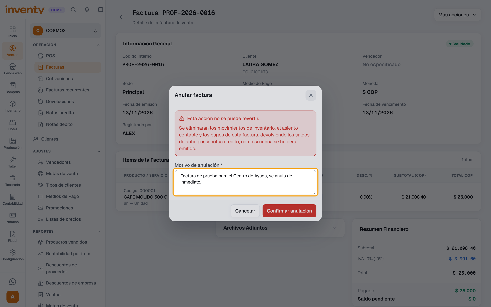
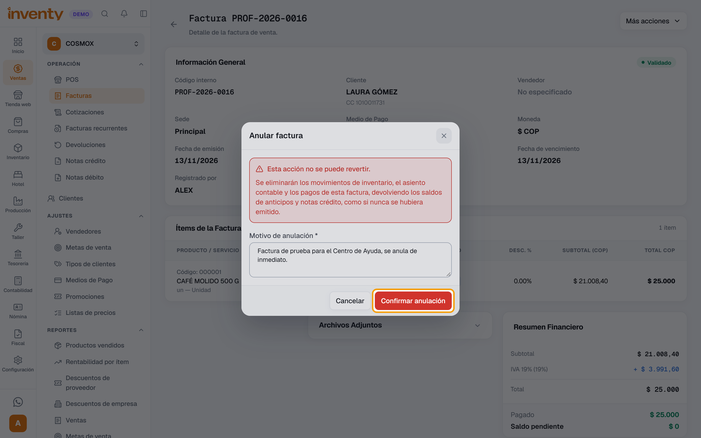

# ¿Cómo anulo una factura de venta?

También se busca como: anular venta, eliminar factura, deshacer una venta, cancelar factura, factura hecha por error, reversar factura.

**Qué hace:** anula la factura **como si nunca se hubiera emitido**: revierte el inventario (stock, lotes y seriales), borra los pagos, libera los anticipos y notas crédito que aplicó, y reversa su asiento contable y sus movimientos de caja o banco.

**Antes de empezar:** solo se puede anular una factura con estado **Validada**. Una factura en **Borrador** se edita o se elimina directamente; una ya **Anulada** no se puede volver a tocar.

## ¿Y si la factura es electrónica?

Depende del estado de su documento electrónico ante la DIAN:

| Estado del documento electrónico | ¿Se puede anular? | Qué pasa |
|---|---|---|
| **Pendiente** (la DIAN todavía no responde) | No, todavía | Espera la respuesta antes de intentarlo. |
| **Rechazado** (por la DIAN o por el proveedor tecnológico) | Sí | Se anula igual que una factura sin documento electrónico: como el documento nunca tuvo efecto legal, **no genera nota crédito**. |
| **Aceptado** o **Aceptado con observaciones** — factura electrónica normal | Sí | Inventy emite sola una **nota crédito de anulación** (sin saldo a favor del cliente, porque la factura deja de existir). El dinero que el cliente ya pagó se devuelve **por fuera del sistema**: la anulación no hace esa devolución. |
| **Aceptado** — es un **Documento Equivalente POS** | No, nunca | Un documento equivalente POS se corrige con una nota de ajuste, no con anulación. Registra una [devolución de venta](devolucion-venta.md). |

!!! tip "¿No sabes el estado del documento?"
    Consúltalo en Fiscal › Documentos o en [¿Qué significa cada estado de un documento electrónico?](../facturacion-electronica/estados-documento.md) antes de intentar anular.

## Pasos

**Paso 1.** Abre la factura: Ventas › Facturas y haz clic en ella.

**Paso 2.** En el menú de acciones, haz clic en **Anular**. Si no aparece, revisa la tabla de abajo: algo lo está impidiendo.

**Paso 3.** Escribe el **Motivo de anulación** (mínimo 5 caracteres). Es obligatorio y queda guardado.

**Paso 4.** Haz clic en **Confirmar anulación**.

✅ **Listo:** verás *"Factura [código] anulada."* La factura queda en estado **Anulada**, sin inventario, pagos ni asiento contable.

!!! info "Si tu empresa exige autorización para anular"
    El botón dice **Solicitar anulación** en vez de **Confirmar anulación**. Se envía la solicitud y la factura se anula sola cuando un autorizador la aprueba desde Configuración › Autorizaciones.

## Si algo falla

| Si la factura… | Inventy dice | Qué hacer en su lugar |
|---|---|---|
| Ya está anulada | *Esta factura ya ha sido anulada.* | Nada que hacer: ya quedó sin efecto. |
| Tiene documento electrónico pendiente o es un Documento Equivalente POS | Ver la tabla de arriba, [¿Y si la factura es electrónica?](#y-si-la-factura-es-electronica) | Según el caso: espera la respuesta de la DIAN, o registra una [devolución de venta](devolucion-venta.md). |
| Tiene pagos registrados | *No se puede anular esta factura porque tiene pagos registrados por valor de $…* | Elimina o reversa los pagos primero, o usa una [devolución](devolucion-venta.md) si el dinero ya no se puede tocar. |
| Se pagó en una caja que ya se cerró | *No se puede anular esta factura porque su pago quedó en una caja que ya fue cerrada.* | Pide a un supervisor que [corrija el cierre o reabra la sesión de caja](../pos/cierre-de-caja.md). |
| Tiene devoluciones confirmadas | *No se puede anular esta factura porque tiene devoluciones confirmadas.* | No se puede anular: ya tiene movimientos posteriores sobre ella. |
| Tiene notas débito confirmadas | *No se puede anular esta factura porque tiene notas débito confirmadas.* | No se puede anular por la misma razón. |
| Está en un despacho **en borrador** | *…está en el despacho [código], que aún está en borrador.* | Quita la factura del despacho o cancela el despacho, y vuelve a intentarlo. |
| Está en un despacho que ya salió a ruta o se liquidó | *…está en el despacho [código], que ya salió a ruta o fue liquidado; registra una devolución.* | Registra una [devolución de venta](devolucion-venta.md). |
| Viene de una preventa y ya tiene documento electrónico | *…porque viene de una preventa y ya tiene documento electrónico; registra una devolución.* | Registra una [devolución de venta](devolucion-venta.md). |
| Se generó en el check-out de una reserva de hotel | *…porque se generó en el check-out de una reserva de hotel; registra una devolución.* | Registra una [devolución de venta](devolucion-venta.md). |
| Tiene líneas convertidas desde una remisión | *No puedes anular una venta que incluye líneas convertidas desde una remisión.* | Registra una [devolución de venta](devolucion-venta.md). |
| Viene de una orden de servicio (Taller) | *No puedes anular una venta generada desde una orden de servicio; registra una devolución.* | Registra una [devolución de venta](devolucion-venta.md). |

!!! tip "Regla general"
    Casi todos estos casos tienen la misma salida: si Inventy no te deja anular, **registra una devolución** en su lugar. La devolución sí funciona sobre facturas con movimientos posteriores — por eso es el camino de respaldo en casi toda la tabla.

## Relacionados

- [¿Cómo registro una devolución de venta?](devolucion-venta.md)
- [¿Cómo hago una factura de venta?](crear-factura-venta.md)
- [¿Qué significa cada estado de un documento electrónico?](../facturacion-electronica/estados-documento.md)
