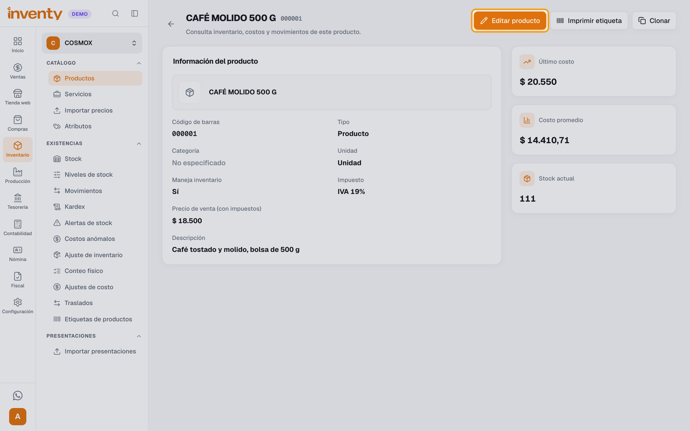
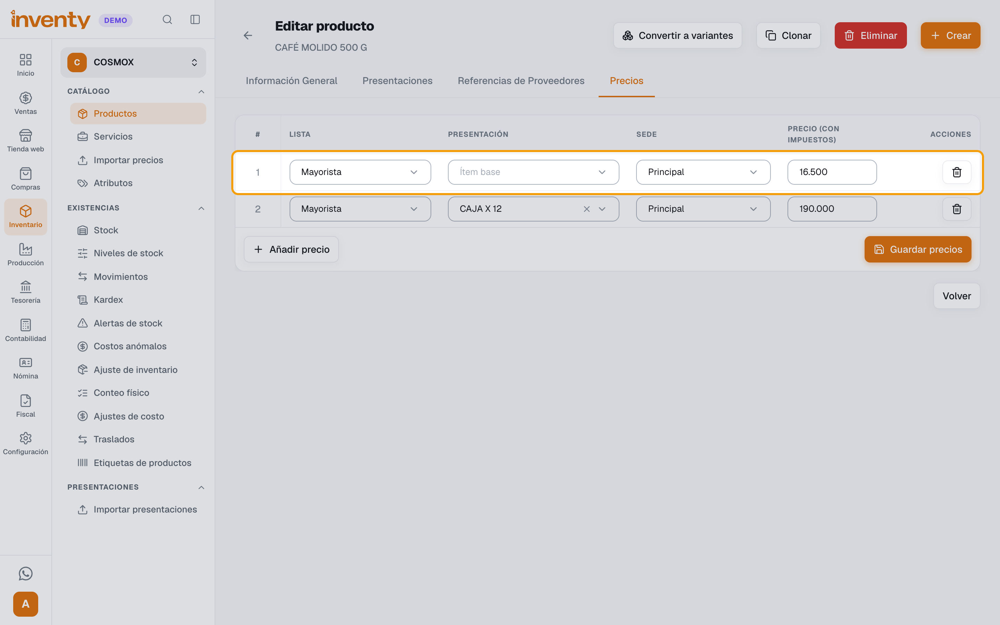
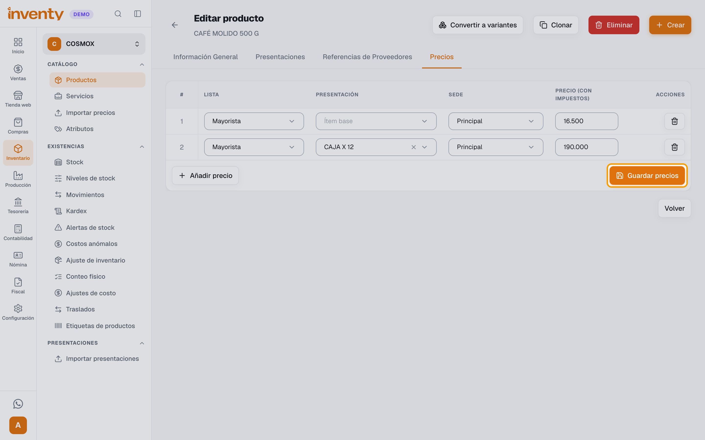
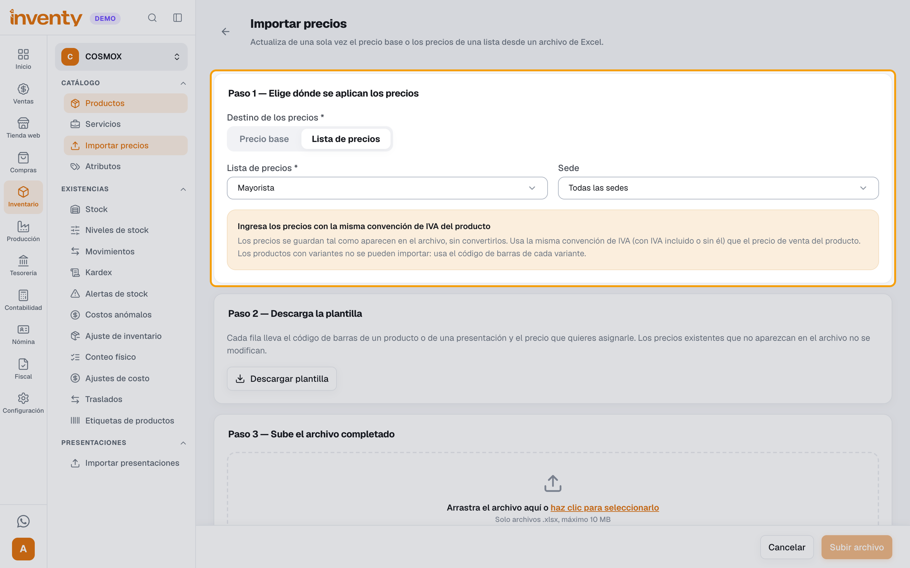
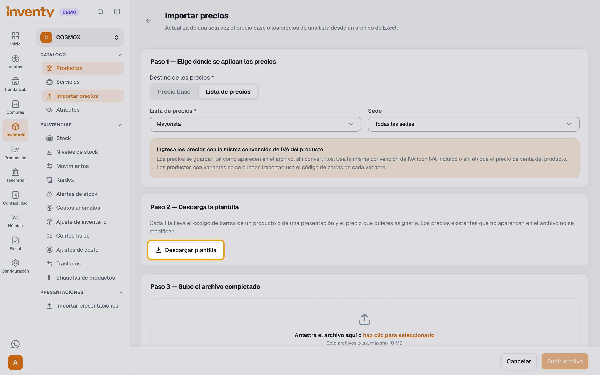
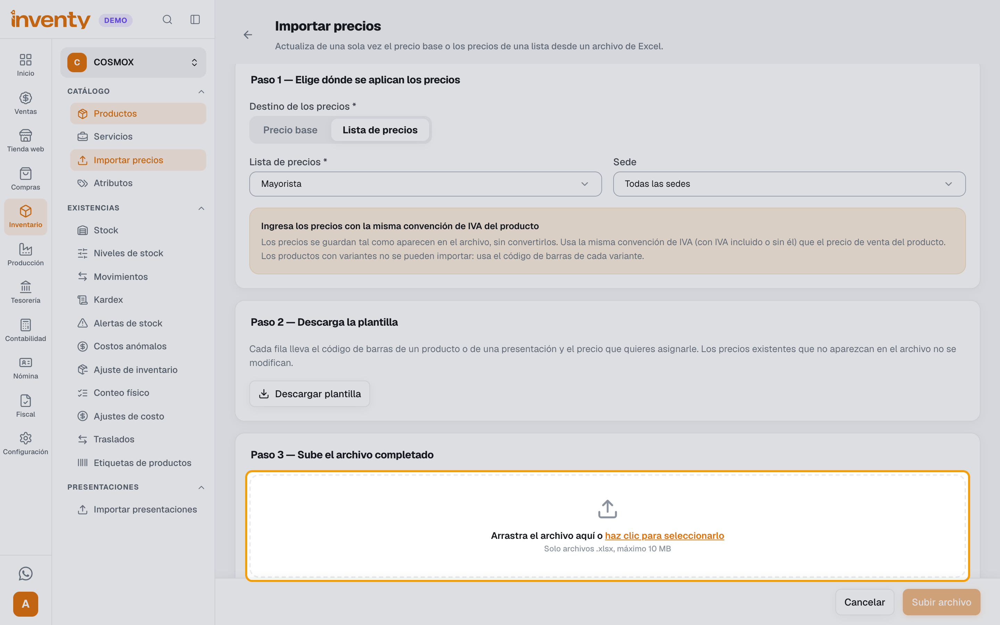

# ¿Cómo corrijo los precios de una lista de precios?

También se busca como: cambiar precio mayorista, modificar lista de precios, precio errado, actualizar precios, editar precio de lista, importar precios.

**Antes de empezar:** la lista ya debe existir. Si aún no la tienes, mira [¿Cómo manejo las listas de precios?](listas-de-precios.md). Los precios no se cambian en la pantalla de la lista: se cambian en cada producto o con un archivo.

## Pasos

Si son **pocos productos**, sigue los pasos 1 a 3 con cada uno.

**Paso 1.** Ingresa a Inventario › Productos, abre el producto y haz clic en **Editar producto**.

**Paso 2.** Abre la pestaña **Precios** y busca la fila de la lista (ej. *Mayorista*). Corrige el **Precio** en esa fila. Hay una fila por **Presentación** y por **Sede**: corrige todas las que estén mal.

**Paso 3.** Haz clic en **Guardar precios**.

Si son **muchos productos**, usa un archivo en lugar de los pasos 1 a 3:

**Paso 4.** Ingresa a Inventario › Importar precios. En **Destino de los precios** haz clic en **Lista de precios**, elige la lista (ej. *Mayorista*) y en **Sede** elige la sede o **Todas las sedes**.

**Paso 5.** Haz clic en **Descargar plantilla**. Escribe en cada fila el **Código de barras** del producto (o de la presentación) y su **Precio** correcto.

**Paso 6.** Arrastra el archivo al recuadro (o haz clic para seleccionarlo) y haz clic en **Subir archivo**. En la vista previa revisa los precios y haz clic en **Aplicar** para guardarlos.

✅ **Listo:** las ventas que hagas desde ahora usan el precio corregido.

!!! warning "Las ventas anteriores no cambian"
    Las facturas que ya se hicieron con el precio errado conservan ese precio. Si necesitas corregir una factura validada, registra una [devolución de venta](devolucion-venta.md).

## Si algo falla

| Problema | Solución |
|---|---|
| *Ya existe un precio para esta lista/presentación/sede.* | No agregues otra fila: cambia el precio en la fila que ya existe. |
| El precio sale con o sin IVA de más | Escribe el precio como lo pide la columna: **Precio (con impuestos)** o **Precio (sin impuestos)**, según tu empresa. En el archivo, usa esa misma forma. |
| Corregí el precio pero el POS sigue cobrando el anterior | Si la venta ya estaba abierta, vuelve a agregar el producto o a elegir el cliente. |
| Un producto quedó con el precio de antes después de importar | Solo cambian los productos que vienen en el archivo. Revisa que su código de barras esté bien escrito. |
| *Este producto tiene variantes…* | En el archivo usa el código de barras de cada variante, no el del producto principal. |
| El cliente mayorista sale más barato de lo esperado | Si su [tipo de cliente](tipos-de-cliente.md) tiene descuento, ese descuento se aplica encima del precio de la lista. |

## Relacionados

- [¿Cómo manejo las listas de precios?](listas-de-precios.md)
- [¿Cómo creo un tipo de cliente?](tipos-de-cliente.md)
- [¿Cómo registro una devolución de venta?](devolucion-venta.md)
