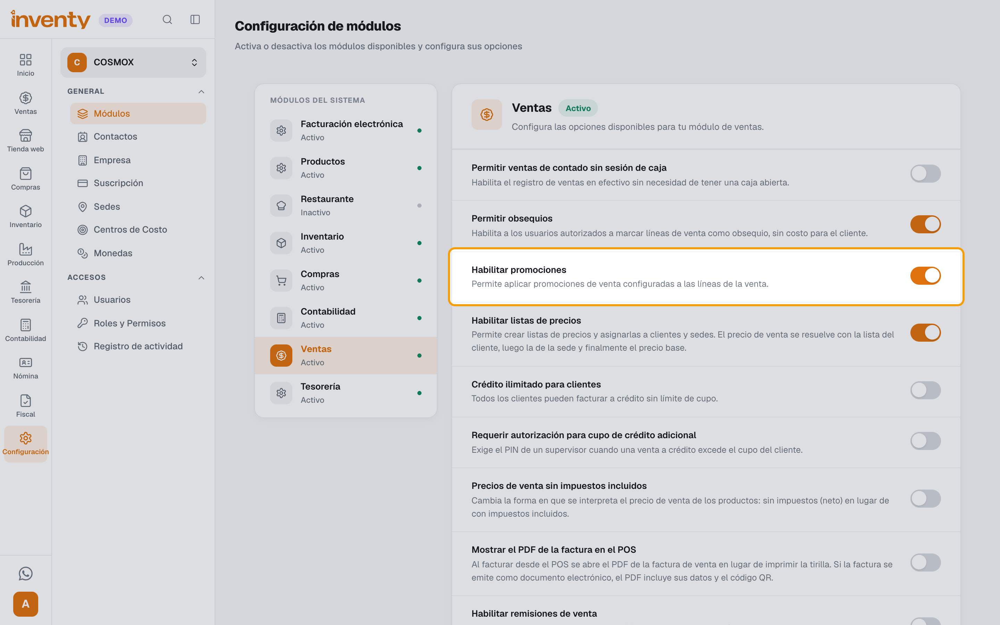
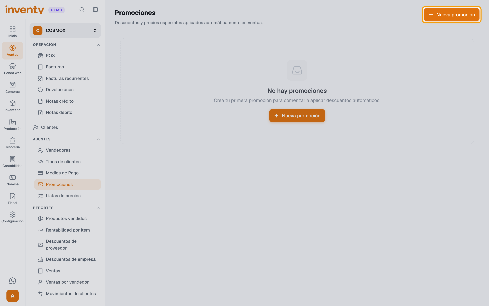
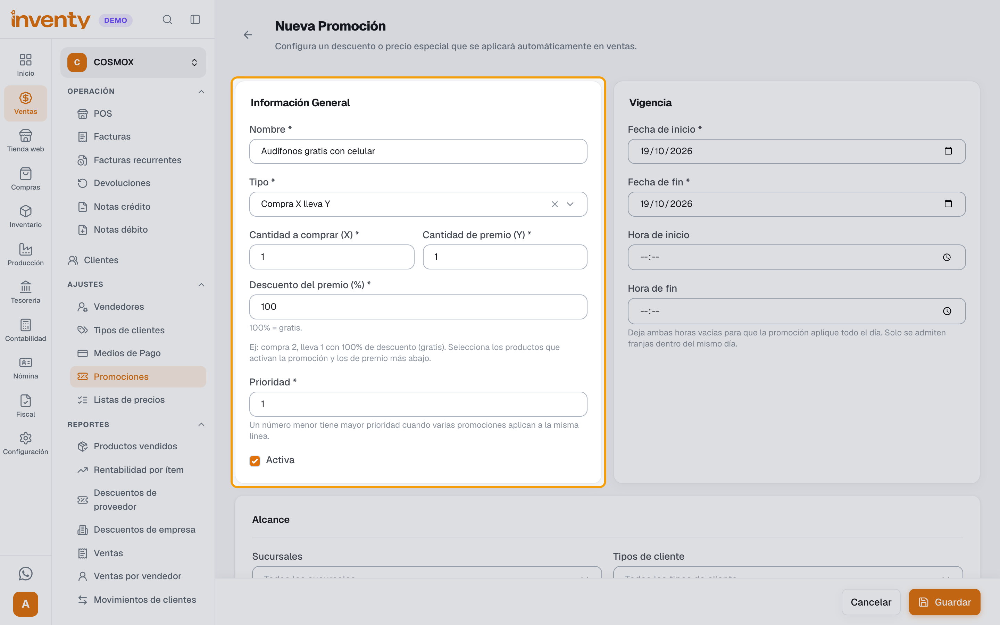
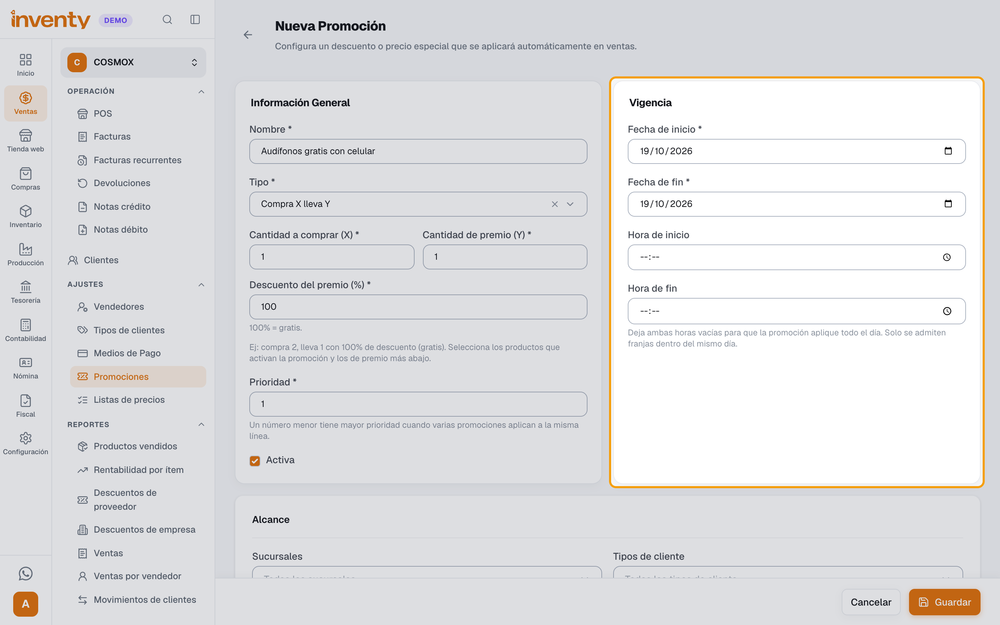
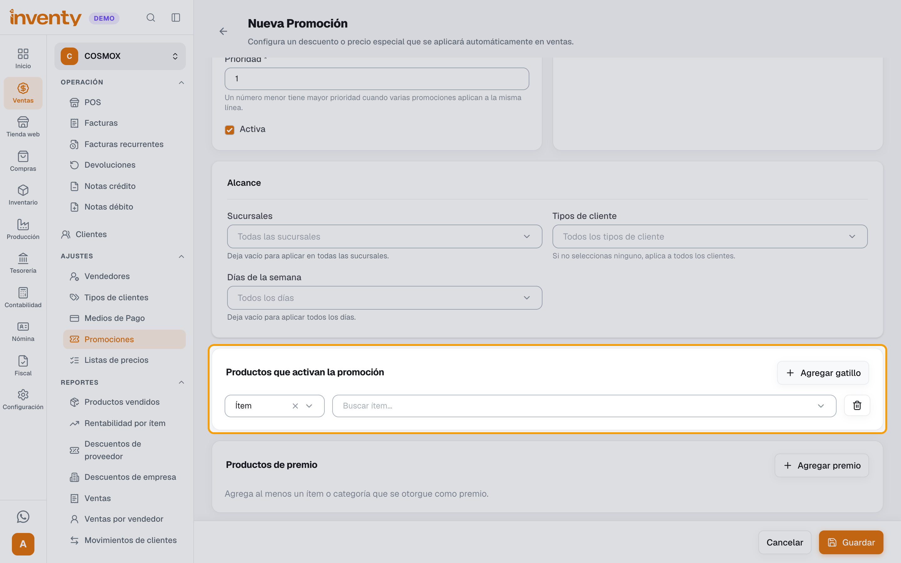
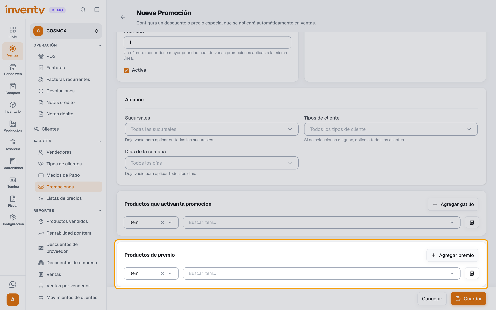
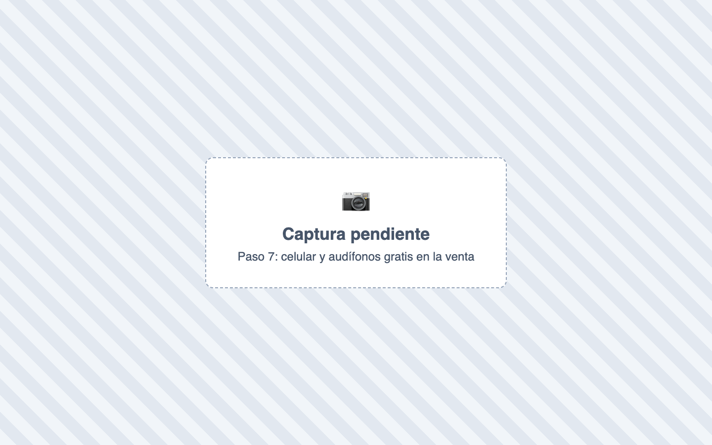

# ¿Cómo regalo un producto al vender otro?

También se busca como: regalo, obsequio, producto gratis, promoción, compra X lleva Y, pague uno lleve dos, combo, 2x1 con otro producto, regalar audífonos, bonificación, premio.

**Ejemplo:** por cada **celular** que vendas, el cliente se lleva unos **audífonos** gratis, en la misma factura.

## Pasos

**Paso 1.** Activa la opción (una sola vez): ingresa a Configuración › Módulos, elige **Ventas** y enciende **Habilitar promociones**.

**Paso 2.** Ingresa a Ventas › Ajustes › Promociones y haz clic en **Nueva promoción**.

**Paso 3.** En **Información General** escribe el **Nombre** (ej. *Audífonos gratis con celular*) y en **Tipo** elige **Compra X lleva Y**. Completa:

- **Cantidad a comprar (X):** *1*
- **Cantidad de premio (Y):** *1*
- **Descuento del premio (%):** *100* (gratis)
- **Prioridad:** deja *1*, salvo que tengas otras promociones sobre los mismos productos. El número menor gana.

Deja marcada **Activa**.

**Paso 4.** En **Vigencia** elige la **Fecha de inicio** y la **Fecha de fin**. Si quieres, limita la promoción en **Alcance** (**Sucursales**, **Tipos de cliente**, **Días de la semana**). Si los dejas vacíos, aplica en todo.

**Paso 5.** En **Productos que activan la promoción** haz clic en **Agregar gatillo** y busca el celular. Puedes elegir un **Ítem** o una **Categoría** completa (ej. *Celulares*).

**Paso 6.** En **Productos de premio** haz clic en **Agregar premio**, busca los audífonos y haz clic en **Guardar**.

**Paso 7.** Vende normal en el POS o en una factura de venta. Al agregar el celular, Inventy agrega los audífonos en **$0** y la línea muestra **Promoción:** con el nombre de la promoción.

✅ **Listo:** cada celular vendido lleva sus audífonos gratis en la misma factura, y el inventario de ambos productos baja.

## ¿Y si ya facturaste el celular sin el regalo?

Si el celular ya salió en otra factura (por ejemplo, ya enviada a la DIAN), **no hagas otra venta solo con los audífonos**. Inventy no permite una venta solo de obsequios. Saca los audífonos con un ajuste de inventario:

1. En Inventario › Ajuste de inventario, abre la pestaña **Conceptos de ajuste** y crea un concepto de **Salida** (ej. *Obsequio a clientes*). En **Cuenta contable de contrapartida**, elige la cuenta que indique tu contador (ej. *Bonificaciones* o publicidad). Esto se hace una sola vez.
2. Haz un [ajuste de inventario](../productos-inventario/ajuste-inventario.md) de **salida** de los audífonos con ese **Concepto**. En **Observacion** escribe el número de la factura del celular, para que quede la trazabilidad.
3. Revisa la **Previsualización del asiento del ajuste** y haz clic en **Confirmar ajuste**.

## ¿Promoción u obsequio?

| | Promoción **Compra X lleva Y** | Producto **obsequio** |
|---|---|---|
| Cómo se aplica | Sola, cada vez que se vende el producto que la activa | El producto está marcado como obsequio y un usuario con permiso lo autoriza |
| ¿Puedo vender los audífonos aparte, a precio normal? | **Sí** | **No en el POS**: mientras estén marcados, siempre salen en $0 |
| Qué queda registrado | Nombre de la promoción en la línea y en el reporte de descuentos | Quién autorizó el obsequio y cuándo |
| Úsalo para | Campañas (celular + audífonos) | Productos que solo regalas (llaveros, bolsas, muestras) |

Para usar obsequios: enciende **Permitir obsequios** en Configuración › Módulos › Ventas, activa **Producto de obsequio** en el producto (con su **Cantidad máxima de obsequio por venta**) y dale al usuario el permiso **Autorizar obsequios en venta**.

## ¿Cómo queda en la contabilidad?

Con la promoción o con el obsequio, la venta del celular con audífonos gratis genera este asiento:

| Cuenta | Débito | Crédito |
|---|---|---|
| Caja, bancos o clientes | Lo que pagó el cliente | |
| Ingresos por ventas | | Solo el celular |
| IVA ventas | | Solo el IVA del celular |
| Costo de ventas | Costo del celular **+ costo de los audífonos** | |
| Inventario | | Costo del celular **+ costo de los audífonos** |

- El inventario de los audífonos **sí baja** y su costo se registra en **costo de ventas**.
- Los audífonos **no generan ingreso ni IVA**, porque su línea vale $0.
- El costo del regalo **queda sumado al costo de ventas**, no en una cuenta aparte. Si tu contador lo quiere separado (ej. en *Bonificaciones*), debe reclasificarlo con un asiento manual en Contabilidad › Asientos Contables.

!!! warning "Consulta con tu contador"
    Entregar mercancía de regalo puede tener efectos tributarios (por ejemplo, IVA por retiro de inventario). Inventy no los calcula automáticamente. Tu contador debe decidir si hay que registrar algo adicional.

## Si algo falla

| Problema | Solución |
|---|---|
| No aparece **Promociones** en el menú | Enciende **Habilitar promociones** (paso 1) y revisa que tu rol tenga el permiso **Ver promociones**. |
| Vendí el celular y los audífonos salieron con precio | Revisa que la promoción esté **Activa**, dentro de su **Vigencia** y que el **Alcance** incluya tu sede, el día y el tipo de cliente. |
| No se agregaron solos los audífonos | Pasa cuando el premio es una **categoría** o varios productos. La línea del celular dice qué premio le corresponde: agrégalo tú y sale con el descuento. |
| *No se puede editar el precio de una línea con promoción aplicada.* | Es normal: la promoción fija el precio. Si no aplica, quita el producto o desactiva la promoción. |
| *Una venta de solo obsequios no está permitida…* | Agrega al menos un producto con precio. Si la venta principal ya se facturó, usa el ajuste de inventario (ver arriba). |
| *La cantidad de obsequio de "…" supera el máximo permitido* | Baja la cantidad o cambia la **Cantidad máxima de obsequio por venta** en el producto. |
| *No tienes autorización para marcar líneas como obsequio en esta factura.* | Enciende **Permitir obsequios** y pide el permiso **Autorizar obsequios en venta**. |
| El cliente devuelve el celular | Al registrar la devolución, Inventy agrega solos los audífonos a la devolución (*Devuelto automáticamente por la promoción «…»*). |

## Relacionados

- [¿Cómo hago un ajuste de inventario?](../productos-inventario/ajuste-inventario.md)
- [¿Cómo vendo en el POS?](../pos/vender-en-pos.md)
- [¿Cómo hago una factura de venta?](crear-factura-venta.md)
- [¿Cómo registro una devolución de venta?](devolucion-venta.md)
- [Todas las opciones de Configuración › Módulos](../primeros-pasos/opciones-modulos.md)
